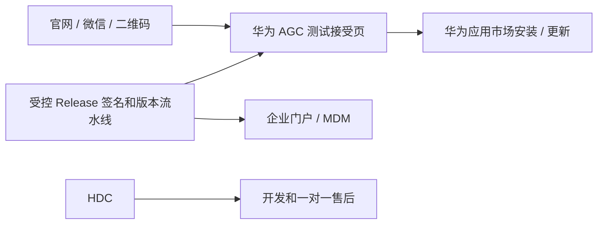

# HarmonyOS 6.0.2+ 分发策略

> 更新：2026-08-12（Asia/Shanghai）
> 边界：当前单包最低兼容 API 22（HarmonyOS 6.0.2）；这是安装与更新架构，不是规避华为审核、VPN 资质或当地法律的方案。

## 产品结论

对普通消费者，目前没有官方证据支持“任意用户从网页下载开发者自签 HAP，点一下即可长期安装和自动更新”。用户体验最好、且仍在华为信任链内的方案是 AGC 应用测试。

| 场景 | 推荐通道 | 体验 | 不可宣称的事 |
| --- | --- | --- | --- |
| 0–100 名种子用户 | AGC 内部测试 | 通过华为应用市场安装；内部测试免人工审核，通常数小时可用 | 不是永久、无限人数、免政策审查的公开商店 |
| 100–5000 名可识别用户 | AGC 邀请测试 | 邮箱/手机号形式的华为账号接受邀请，再从应用市场安装 | 邀请版本仍可能需要提交审核，不能借此绕过 VPN 分类 |
| 面向公开招募的有限测试 | AGC 公开测试/邀请码 | 二维码只跳转到华为的测试接受页 | 不是永久替代公开上架的通道 |
| 真实企业客户/受管设备 | 企业内部证书 + 企业门户/MDM | IT 下发或企业网站二维码 | 不得把面向公众的 VPN 伪装成企业内部应用 |
| 开发、现场售后 | HDC + 指定设备 Profile | 需电脑、USB 调试和设备授权 | 不是普通用户分发方案 |

停止测试后，新用户不能安装；已参与用户的存量体验受官方测试规则约束，不应把测试当成无期限发行承诺。VPN API 还定义了“crowdtesting application expires”错误，因此客户端必须把测试到期当作可解释的分发状态，不得误报成节点或 VPN 内核故障。

## 建议的交付架构

1. **官网/帮助页**：只提供产品说明、隐私政策、版本记录和“加入测试”。二维码跳转华为测试链接，不托管可点击安装的原始 HAP。
2. **测试名单服务**：只保存受邀华为账号、协议版本和邀请状态；不收集订阅 URL、节点凭据或浏览流量。
3. **版本通道**：内部、邀请和企业通道分别维护单调递增 `versionCode`、签名身份、发布记录和 SHA-256。同一已安装渠道必须保持签名连续。
4. **更新体验**：应用可查询版本并提醒用户返回华为渠道更新；不设计静默安装、自更新 HAP 或动态替换 `.so`。
5. **可追溯交付**：每个版本对应 Git commit、sing-box/core lock、补丁集、签名包哈希和真机验收报告；测试分发不降低 VPN 与隐私门禁。

## 立即可执行的顺序

1. 先在 AGC 创建内部测试组，仅纳入已知 100 人以内的种子用户。
2. 取得华为对 VPN/代理类别的书面工单结论；内部测试成功不等于正式上架资质已通过。
3. 当用户数和回归稳定后升级为邀请测试，同时准备审核专用合法配置、隐私正文和支持流程。
4. 只为签约企业客户开设企业证书/Profile 和 MDM 通道；公众用户不入管。
5. 如果 AGC 测试也因 VPN 分类被拒，在获得华为书面例外或平台政策改变之前，不存在同时“面向普通用户、简单、长期、免审”的原生 HarmonyOS 合规分发方案。

## 官方参考

- [AGC 开放式测试](https://developer.huawei.com/consumer/cn/agconnect/open-test/)
- [HarmonyOS 三种用户测试](https://developer.huawei.com/consumer/cn/testing/get-started/)
- [AppGallery 测试与发布入口](https://developer.huawei.com/consumer/cn/appgallery)
- [应用安装、卸载与更新](https://developer.huawei.com/consumer/cn/doc/doccenter-getting-started/application-package-install-uninstall)
- [VPN Extension API](https://developer.huawei.com/consumer/cn/doc/harmonyos-references-V5/js-apis-net-vpnextension-V5)
- [指定设备 Profile API](https://developer.huawei.com/consumer/cn/doc/doccenter-submission/agc-help-provision-api-update-provision-0000002469198766)
- [企业网站/二维码内部安装边界](https://consumer.huawei.com/cn/support/content/zh-cn16061787/)
- [华为 MDM 资质与场景](https://developer.huawei.com/consumer/cn/hms/right-sign/)
